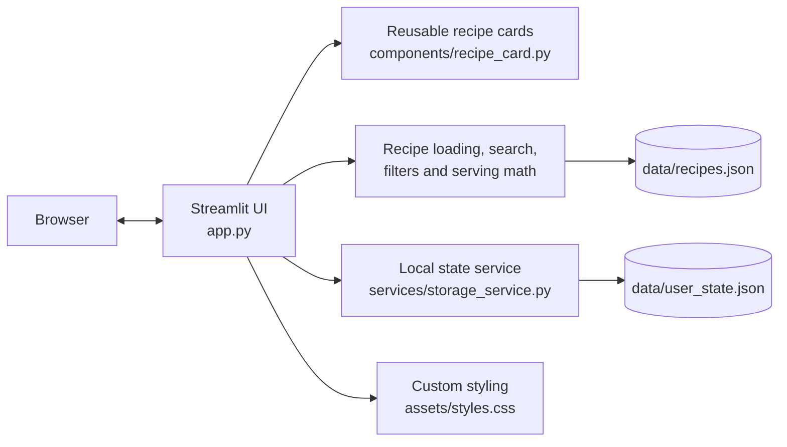
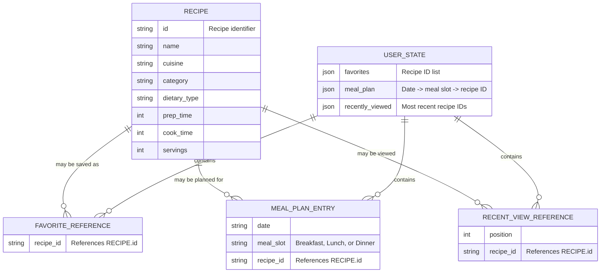
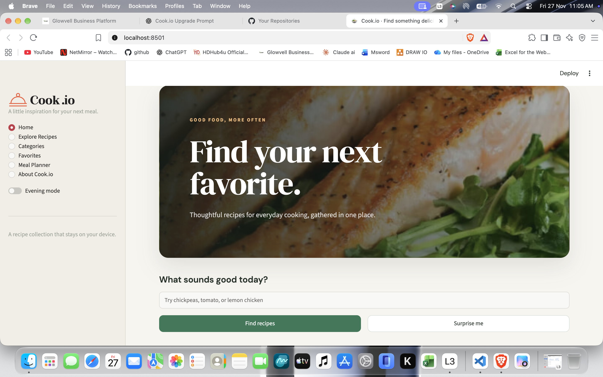
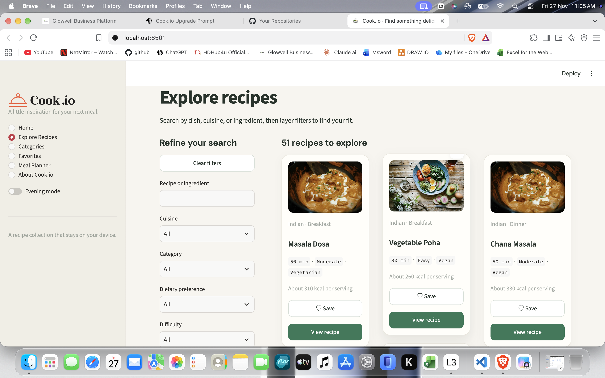
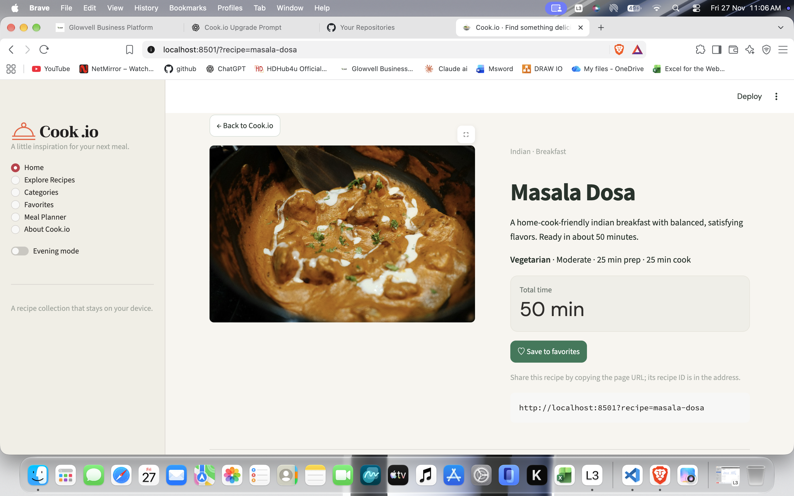
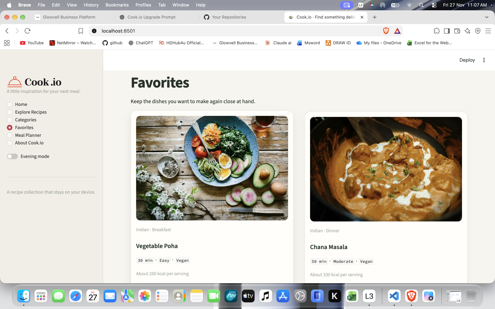
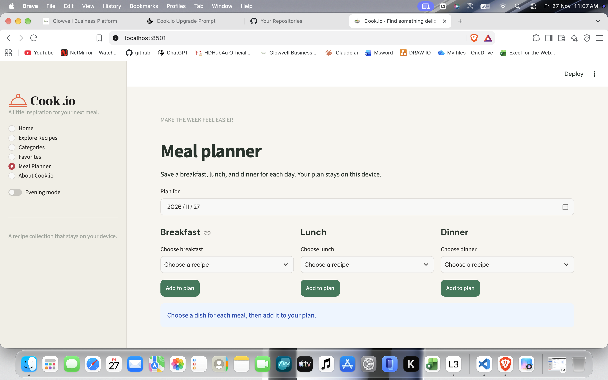
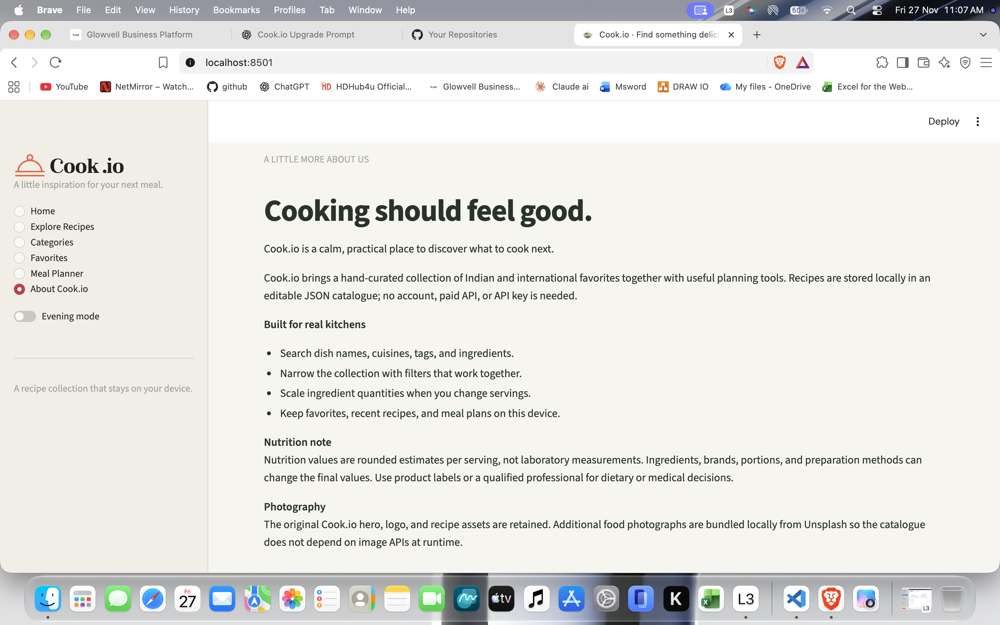

# Cook.io — Recipe Discovery & Meal Planning

[](https://www.python.org/)
[](https://streamlit.io/)
[](#storage-architecture-and-data-model)

Cook.io is a local-first recipe discovery and meal-planning application built
with Python and Streamlit. Browse a bundled catalogue of 51 Indian and
international recipes, find dishes by name or ingredient, scale servings, and
keep favorites and meal plans in a local JSON file.

> **Run the app:** `streamlit run app.py`

## Project overview

Cook.io turns the original static recipe-site concept into a self-contained
Streamlit application. The supported app entry point is `app.py`; recipe data
and user state are stored as local JSON. The app does not require an account,
external recipe API, paid service, or database server.

### Objectives

- Make a curated recipe collection easy to browse and search.
- Combine practical recipe filters without relying on third-party APIs.
- Provide useful cooking details, adjustable ingredient quantities, and
  approximate nutrition at a glance.
- Keep favorites, recently viewed recipes, and meal plans on the machine
  running the app.
- Retain Cook.io branding and original static assets while providing a
  maintainable Python application.

## Features

| Area | Implemented functionality |
| --- | --- |
| Home | Search shortcut, popular recipes, cuisine links, recently added recipes, and a random recipe suggestion |
| Explore | Search recipe names, descriptions, cuisines, categories, tags, dietary types, and ingredient names |
| Combined filters | Cuisine, meal category, dietary type, total cooking time, and difficulty |
| Sorting | Popularity, quickest, and alphabetical |
| Categories | Browse by cuisine or meal category |
| Recipe details | Local image with fallback, description, times, difficulty, dietary type, ingredients, instructions, and related recipes |
| Servings | Change serving count and scale ingredient quantities with kitchen-friendly fractions |
| Nutrition | Rounded estimated calories and macronutrients, with a Plotly chart |
| Favorites | Add or remove saved recipes; persist them in local JSON |
| Meal planner | Assign recipes to breakfast, lunch, and dinner for a selected date; remove planned entries |
| History | Keep up to 12 recently viewed recipe IDs |
| Sharing | Recipe detail URLs use a `?recipe=<recipe-id>` query parameter and can be copied from the page |
| Appearance | Sidebar navigation and an evening/dark appearance toggle |
| Reset | Clear saved favorites, planner entries, and recent history from the app |

Nutrition figures are approximate per-serving estimates, not laboratory
measurements or medical advice. Recipe instructions and ingredient amounts are
provided as cooking guidance and should be adapted to ingredients and equipment.

## Technology stack

| Layer | Technology used |
| --- | --- |
| Frontend / UI | Streamlit widgets and custom CSS in `assets/styles.css` |
| Application logic | Python in `app.py`, `services/`, and `components/` |
| Recipe catalogue | `data/recipes.json` |
| User data | `data/user_state.json`, created at runtime and excluded from Git |
| Data presentation | Pandas and Plotly for the nutrition chart |
| Image handling | Bundled local images; Pillow is used in image-integrity tests |
| Tests | pytest and Streamlit `AppTest` |
| ORM | None |
| SQL database | None in the Cook.io application |

The recipes are validated and loaded by `services/recipe_service.py`. The
curated seed records and JSON catalogue generator are in
`scripts/generate_recipes.py`. User state is read and atomically written by
`services/storage_service.py`.

## Application architecture



The application uses a single Streamlit navigation system in `app.py`; it does
not use a `pages/` directory or a separate web frontend. The legacy HTML, CSS,
and JavaScript files remain in the repository as static-site reference
material. The retired browser-side recipe API client does not make API calls.

## Project structure

```text
cook.io/
├── app.py                         # Streamlit entry point and page workflows
├── requirements.txt               # Runtime and test dependencies
├── README.md
├── .gitignore
├── favicon.svg
├── index.html                     # Retained legacy static site
├── recipes.html                   # Retained legacy static site
├── detail.html                    # Retained legacy static site
├── saved-recipes.html             # Retained legacy static site
├── index                          # Legacy text/export artifact, not an entry point
├── tempCodeRunnerFile.python      # Unrelated attendance prototype, not used by Cook.io
├── .vscode/
│   └── settings.json
├── assets/
│   ├── styles.css                 # Streamlit application styling
│   ├── css/
│   │   └── style.css              # Legacy static-site styling
│   ├── images/                    # Nine locally bundled recipe photos
│   ├── img/                       # Original Cook.io branding and fallback assets
│   └── js/                        # Retained legacy browser scripts
├── components/
│   ├── __init__.py
│   └── recipe_card.py             # Reusable Streamlit recipe cards
├── data/
│   └── recipes.json               # Bundled recipe catalogue
├── scripts/
│   └── generate_recipes.py        # Regenerate the catalogue
├── services/
│   ├── __init__.py
│   ├── recipe_service.py          # Load, validate, search, filter, scale
│   └── storage_service.py         # Favorites, planner, and recent history
└── tests/
    ├── test_recipes.py
    ├── test_search.py
    ├── test_storage.py
    └── test_recipe_cards.py
```

`data/user_state.json` is created when the app saves user state. It is
intentionally ignored by Git and is not included in the repository tree above.

## Storage architecture and data model

### Current storage

Cook.io does **not** currently use SQLite or PostgreSQL. There are no SQL
tables, database connection settings, ORM models, or database migrations in
the application. Instead:

- `data/recipes.json` is the bundled catalogue of 51 recipes. Each recipe has
  an ID, name, description, image path, cuisine, category, dietary type,
  preparation/cooking/total time, difficulty, servings, ingredients,
  instructions, estimated nutrition, tags, and popularity.
- `data/user_state.json` is created locally to store a favorites list, a
  date-keyed meal plan, and a recently viewed list. Writes use a temporary file
  and atomic replacement.
- Recipe IDs in the user-state file refer to recipe IDs in the catalogue.

The following ER-style diagram describes the **logical relationships only**.
These are not SQL tables: the current implementation stores the recipe
catalogue and the whole user-state object in JSON files.



### SQLite setup

SQLite is **not configured for the Cook.io app**, so there is no Cook.io SQLite
database to initialize and no SQLite setup command to run. The file
`tempCodeRunnerFile.python` is an unrelated attendance-system prototype that
mentions SQLite; it is not imported or used by `app.py`.

### PostgreSQL production configuration

PostgreSQL is **not currently supported or configured**. The project has no
PostgreSQL driver, `DATABASE_URL` setting, SQL schema, or database-backed
storage adapter. Do not set PostgreSQL credentials expecting this version of
Cook.io to use them. A database-backed multi-user deployment would require
implementing and testing that support first.

### Database migrations

There are no Alembic files, migration scripts, ORM models, or SQL migrations.
`python scripts/generate_recipes.py` rebuilds the JSON recipe catalogue; it is
not a database migration. Back up any local `data/user_state.json` before
replacing or editing state. A future SQL migration would need an explicit data
mapping, schema, and migration process.

## Screenshots

The screenshots below are captured from the running Cook.io application.

### Home

The landing page introduces Cook.io and provides recipe search and a random
recipe suggestion.



### Explore recipes

Search the catalogue and combine cuisine, category, dietary, time, and
difficulty filters.



### Recipe details

View recipe information, cooking steps, adjustable servings, and estimated
nutrition.



### Favorites

Review recipes saved to the local favorites collection.



### Meal planner

Plan breakfast, lunch, and dinner for a selected date.



### About Cook.io

Learn about the app, its local recipe catalogue, and nutrition estimates.



> **Screenshot filename note:** `admin-dashboard.png` shows the About Cook.io
> page. The current application does not include an admin dashboard.

## Requirements

- Python 3.10 or newer is the documented target.
- pip and a virtual environment.
- Dependencies listed in `requirements.txt`:
  - Streamlit 1.50+
  - Pandas 2.0+
  - Pillow 10+
  - Plotly 5.18+
  - pytest 7+ for tests

The requirements file also sets upper bounds for these packages. No Node.js,
external API key, SQL server, or paid service is required.

## Installation and setup

Run commands from the project root.

### 1. Create a virtual environment

**macOS / Linux**

```bash
python3 -m venv .venv
source .venv/bin/activate
```

**Windows PowerShell**

```powershell
py -m venv .venv
.venv\Scripts\Activate.ps1
```

If PowerShell activation is restricted by local policy, activate the
environment using Command Prompt instead:

```bat
.venv\Scripts\activate.bat
```

### 2. Install dependencies

```bash
python -m pip install --upgrade pip
python -m pip install -r requirements.txt
```

### 3. Run Cook.io

```bash
streamlit run app.py
```

Streamlit prints the local URL in the terminal (normally
`http://localhost:8501`). Keep the terminal running while using the app.

### 4. Run tests

```bash
python -m pytest -q
```

To run a focused test module:

```bash
python -m pytest tests/test_recipes.py -q
python -m pytest tests/test_search.py -q
python -m pytest tests/test_storage.py -q
python -m pytest tests/test_recipe_cards.py -q
```

To regenerate the bundled recipe data:

```bash
python scripts/generate_recipes.py
```

Review the generated JSON before committing changes.

## Environment variables and secrets

The current app reads **no environment variables** and requires no API keys or
credentials. There is intentionally no `.env.example` file because there are
no application settings to configure through `.env`. No `.env` file is needed
to run Cook.io.

The `.gitignore` excludes `.streamlit/secrets.toml`. If a future feature
requires secrets, configure them using Streamlit's secrets management for the
deployment environment and keep actual credentials out of source control. Do
not add example secrets or real tokens to the repository.

## Authentication, security, and admin functionality

- There is no login, account registration, role system, or user authentication.
- There is no admin dashboard or privileged admin functionality.
- The app is designed as a local, single-user recipe tool. Favorites, meal
  plans, and history are plain JSON on the machine running Streamlit; they are
  not encrypted or separated by account.
- Do not store passwords, personal information, or other sensitive data in
  `data/user_state.json`.
- The supported Streamlit app uses bundled recipe/image data and does not need
  an API key. The retained legacy static pages are not the supported
  application entry point.
- `data/user_state.json` is ignored by Git. Check that no local state or
  credentials are staged before publishing changes.

## Deployment: Streamlit Community Cloud

Cook.io can be used as a portfolio/demo deployment on
[Streamlit Community Cloud](https://streamlit.io/cloud):

1. Push the project to a GitHub repository.
2. Sign in to Streamlit Community Cloud and select **Create app**.
3. Choose the repository and branch.
4. Set the app file path to `app.py`.
5. Deploy. Community Cloud installs the dependencies from the root
   `requirements.txt`.
6. Open the generated app URL and verify recipe browsing and detail views.

No secrets configuration is required for the current app. **Important data
limitation:** the JSON user state is local to the app's server environment,
not to each visitor's browser or account. It is shared by sessions using that
app instance and may not survive restarts or redeployments. Do not treat this
file-based setup as private per-user storage or as durable production storage.
Use a persistent, access-controlled storage design before supporting multiple
users or collecting personal data.

## Future improvements

- Add authenticated, per-user accounts and isolated persistent storage.
- Implement a tested database-backed repository before introducing SQLite or
  PostgreSQL.
- Add database schema migrations if relational storage is introduced.
- Expand the recipe catalogue and improve recipe-specific instructions.
- Add exportable shopping lists and calendar integration.
- Evaluate nutrition estimates against a clearly identified data source.
- Add real screenshots to the repository.

## Project and author information

- **Project:** Cook.io — Smart Recipe Discovery Platform
- **Repository:** [github.com/mayankspppp/cook.io](https://github.com/mayankspppp/cook.io)
- **Maintainer:** [@mayankspppp](https://github.com/mayankspppp)
- **Original static-site attribution:** retained legacy source files credit
  `codewithsadee`; see those files for their original notices.
